# PathSnap — Distributed Map Matching & Route Reconstruction

PathSnap turns noisy GPS observations into road-network routes. The evaluator application uses the existing Phase 2 model, normalizes its candidate scores within each observation, and compares independent top-1 selections with a route decoded by a directed HMM/Viterbi implementation.

## Architecture

```mermaid
flowchart LR
  U[React + Leaflet evaluator UI] -->|REST / JSON| A[FastAPI]
  A --> D[Route-free Phase 1 candidate generation]
  D --> F[14-feature schema]
  F --> M[Saved Random Forest pipeline]
  M --> P[Candidate score normalization]
  P --> H[Directed HMM + Viterbi]
  H --> R[Classifier and decoded route results]
  R --> L[Leaflet map and Folium HTML map]
```



Inference reads only `.track`, `.nodes`, and `.arcs`. It never reads a `.route` file. Model scores are normalized for within-observation route selection; they are not calibrated probabilities.

## Project layout

| Path | Purpose |
|---|---|
| `src/data/` | Raw PathSnap data loaders, candidate generation, route alignment for training labels |
| `src/features/` | Phase 1 feature engineering, route-free inference features, Folium visualizations |
| `src/models/` | Phase 2 model, trip-grouped validation, optimization, and artifacts |
| `hmm/` | Emission/transition helpers, integrated directed decoder, Viterbi implementation |
| `backend/` | FastAPI app and model-backed inference service |
| `frontend/` | React/Vite evaluator UI with Leaflet map layers |
| `tests/` | Phase 1/2 tests plus route-free HMM and API integration coverage |
| `docs/` | Dataset, model, API, deployment, and architecture documentation |
| `visualizations/maps/` | Existing Phase 1 maps and generated reconstruction maps |
| `report/` | Consolidated technical report source and PDF |

## Team responsibilities

| Member | Area | Integrated status |
|---|---|---|
| Dhanush R | Phase 1 processing and feature engineering | Data loaders, candidate generation, training feature builder, and route-free inference builder |
| Chethan | Phase 2 ML and optimization | Five-model comparison, trip-grouped CV, selected Random Forest, artifact/schema support, probability inference |
| Chandra Raj | HMM and Viterbi | Directed transition decoding, sequence resets for gaps/disconnections, explicit warnings |
| Baby | Backend and evaluator UI | FastAPI routes, model startup validation, uploads, React API integration, Leaflet layers |

## Requirements and data setup

Use Python 3.12 and Node.js 20.19+ or 22.12+ for the Vite 8 frontend.

```powershell
py -3.12 -m venv .venv
.\.venv\Scripts\python.exe -m pip install -r requirements.txt
Expand-Archive -LiteralPath "$env:USERPROFILE\Downloads\Student folder.zip" -DestinationPath "data/raw"
```

Copy `.env.example` to `.env` to override the backend defaults. The frontend reads its own `frontend/.env.local`; copy `frontend/.env.example` there when you need a custom API address.

The raw data layout should be:

```text
data/raw/Student folder/
  train/<8-digit-trip-id>/<id>.track, <id>.nodes, <id>.arcs, <id>.route
  student_test/<8-digit-trip-id>/<id>.track, <id>.nodes, <id>.arcs, <id>.route
```

The demo UI lists the `student_test` trip IDs but reads only `.track`, `.nodes`, and `.arcs` for inference. Training and student-test labels remain outside the inference response.

### Model artifacts

The API loads these files once at startup from `artifacts/`:

- `best_model.pkl`
- `preprocessing_pipeline.pkl`
- `feature_schema.json`
- `model_metadata.json`
- `best_hyperparameters.json`

The selected model files are present in the working project. If a clean clone does not include them, create them deliberately by running the Phase 2 workflow once after installing the raw and processed data:

```powershell
.\.venv\Scripts\python.exe -m src.models.run_phase2 --trials 5 --seed 42
```

Training is not run by the API. The backend reports a degraded health status and a clear missing-artifact message when the files are unavailable or their feature schema is incompatible.

## Run locally

Start the API from the repository root:

```powershell
.\.venv\Scripts\python.exe -m uvicorn backend.main:app --host 127.0.0.1 --port 8000
```

In a second terminal:

```powershell
cd frontend
npm ci
npm run dev -- --host 127.0.0.1
```

Open `http://127.0.0.1:5173`. The frontend uses `VITE_API_BASE_URL`, defaulting to `http://localhost:8000`. Copy `frontend/.env.example` to `frontend/.env.local` to override it.

FastAPI's interactive API documentation is at `http://127.0.0.1:8000/docs`.

## Two-laptop deployment

Both laptops must be on the same trusted Wi-Fi/LAN.

**Laptop 1 — backend**

1. Find its LAN IPv4 address with `ipconfig`.
2. Start the API on all interfaces:

```powershell
.\.venv\Scripts\python.exe -m uvicorn backend.main:app --host 0.0.0.0 --port 8000
```

3. Allow inbound TCP port 8000 in the local firewall for the trusted private network.

**Laptop 2 — frontend**

1. In `frontend/.env.local`, set the backend address, replacing the example IP:

```text
VITE_API_BASE_URL=http://192.168.1.20:8000
```

2. Start Vite on the LAN interface:

```powershell
cd frontend
npm ci
npm run dev -- --host 0.0.0.0
```

3. Open the frontend laptop's LAN URL shown by Vite, usually `http://192.168.1.<frontend>:5173`.

The API accepts browser origins on localhost and private IPv4 ranges by default. Set `PATHSNAP_CORS_ORIGINS` to a comma-separated origin allowlist when the network requires a narrower policy. The frontend `.env.local` value is read at build/start time; restart Vite after changing it.

## API

| Method | Endpoint | Purpose |
|---|---|---|
| `GET` | `/health` | API/model/HMM/data readiness |
| `GET` | `/api/model` | Selected model and actual feature/hyperparameter metadata |
| `GET` | `/api/trips` | List packaged demo and uploaded trip IDs |
| `GET` | `/api/trips/{trip_id}` | GPS preview and graph counts, without labels |
| `POST` | `/api/trips/upload` | Validate and store one `.track`, `.nodes`, and `.arcs` bundle |
| `POST` | `/api/map-match` | Synchronously generate candidates, score them, and decode a route |
| `POST` | `/api/v1/trips/{trip_id}/predict` | Path-based prediction alias |
| `GET` | `/api/trips/{trip_id}/results` | Return the current server-session result |
| `GET` | `/api/trips/{trip_id}/map` | Return the generated Folium map HTML |

`POST /api/map-match` accepts `{"trip_id":"00000001"}`. Uploads are multipart fields named `track_file`, `nodes_file`, and `arcs_file`. `.route` uploads are not accepted.

Map-match results include GPS points, classifier top-1 arc IDs, HMM/Viterbi arc IDs, route segments, candidate-road preview geometry, candidate coverage, route continuity, processing time, model metadata, decoder status, and any reset/fallback warnings. Accuracy/F1 against ground truth is not reported during inference.

## Maps

The React map includes toggles for GPS observations, sampled candidate-road arcs, classifier top-1, and HMM/Viterbi routes. After a map-match request, the `Open Folium map` link opens a separate Folium map saved under `visualizations/maps/` with GPS, sampled candidate arcs, classifier route, and decoded route layers. Existing Phase 1 network and validation maps remain available in the same folder.

## Tests and build

Run the Python suite:

```powershell
.\.venv\Scripts\python.exe -m pytest tests/ -v
```

Build and lint the frontend:

```powershell
cd frontend
npm ci
npm run build
npm run lint
```

The backend integration tests load the saved model and exercise the API using a fixture with no `.route` file. Frontend build/lint checks verify the production bundle and source; manually test trip upload and map matching in a browser after starting both services.

## HMM behavior and limitations

The emission score is the model's candidate score normalized across the observation's candidate set. Transition scores compare traveled distance along a candidate arc (or a directly connected directed arc) with GPS displacement. A broad speed ceiling uses elapsed time. Viterbi runs in log space. A missing candidate set, a gap over 120 seconds, or a candidate-set pair without any direct directed transition starts a new decoding window and adds a warning. The decoder does not invent intermediate roads or bridge disconnected networks; route continuity can therefore remain below 100% and should be interpreted together with the warning list.

`docs/PROJECT_ARCHITECTURE_AUDIT.md` records the initial state. `docs/PHASE2_ML_IMPLEMENTATION.md` documents the trained model comparison. The consolidated team report PDF is `output/pdf/PathSnap_Technical_Report.pdf` with editable source at `report/PathSnap_Technical_Report.md`.
