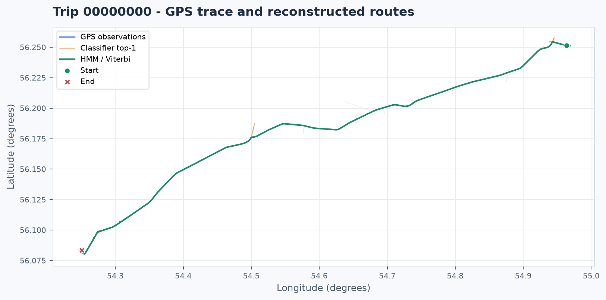

# PathSnap - Distributed Map Matching and Route Reconstruction

## Technical report

**Review date:** 18 November 2026
**Scope:** Existing Phase 1/Phase 2 work and the integrated route inference application
**Selected model:** Tuned Random Forest Classifier

## Executive summary

PathSnap converts noisy GPS observations into directed road-arc sequences. The integrated application generates route-free Phase 1 candidates, scores them with the saved Phase 2 model, normalizes candidate scores within each observation, and decodes a connected sequence with a directed HMM/Viterbi implementation. The React/Leaflet dashboard consumes a FastAPI service; the same inference response also generates a Folium map.

Inference reads only `.track`, `.nodes`, and `.arcs`. Ground-truth `.route` files are not loaded by the API, feature builder, upload endpoint, or route decoder. Training labels and final evaluation are separate workflows.

The integrated checks completed in this workspace:

- Python suite: **41 passed in 12.76 seconds** on the final recorded run.
- Frontend lint: **passed**.
- Frontend production build: **passed** with Vite 8.3.8.
- Live API: model and HMM loaded, all 10 packaged student-test trip IDs listed.
- Route smoke run: trip `00000000`, 2,503 observations, 13,705 candidate rows, complete candidate coverage, decoder status `completed`.
- Folium endpoint: HTTP 200, HTML response 1,251,213 bytes.

The Windows browser automation bridge was unavailable during visual inspection. The API map was generated and served successfully, and this report includes an offline geometry plot from the returned route. A screenshot of the interactive browser UI is not claimed.

## System architecture

```text
React + Leaflet dashboard
        | REST / JSON
        v
FastAPI service and upload validation
        |
        v
Route-free Phase 1 candidate generation
        | 14 approved numeric features
        v
Saved Random Forest pipeline
        | scores normalized within each observation
        v
Directed HMM / Viterbi decoder
        |
        +--> JSON routes and route diagnostics
        +--> Leaflet layers and Folium HTML map
```

The API validates saved artifacts and exact feature order at startup. The model is loaded once per process; the service does not retrain when it starts. Missing or incompatible artifacts produce a degraded health response and disable inference endpoints.

### Repository components

| Component | Responsibility |
|---|---|
| `src/data/` | Track, node, arc, and training-label loaders |
| `src/features/` | Phase 1 candidate generation, features, and route-free inference builder |
| `src/models/` | Phase 2 model comparison, grouped validation, optimization, and inference helpers |
| `hmm/` | Directed transition logic, sequence windows, and Viterbi decoding |
| `backend/` | FastAPI endpoints, artifact validation, uploads, route results, and Folium maps |
| `frontend/` | React/Vite dashboard, trip selection/upload, route diagnostics, Leaflet layers |
| `tests/` | Phase 1/2 tests plus HMM and backend integration tests |

## Data and training protocol

The candidate-level training set contains 1,870,717 candidate rows from 80 trips and 208,417 GPS observations. Model fitting uses observations whose aligned reference road is present in the candidate set: 178,534 observations and 1,742,906 candidate rows. Observations with candidate misses are counted separately and are not treated as classifier errors.

The approved schema has 14 numeric features: snap distance and position, arc length, bearing differences, GPS speed and heading, neighboring time deltas, in/out degree, gap indicators, and heading reliability. Trip ID, observation index, arc ID, target label, and ground-truth candidate flag are not predictive features. Imputation and scaling are fitted within each fold where needed.

Validation uses five-fold `GroupKFold` with trips assigned before filtering. A trip never appears in both the training and validation groups for the same fold. Pooled out-of-fold candidate scores below combine all five held-out folds. Candidate binary metrics use a 0.5 threshold; top-1 accuracy selects the highest-scoring candidate separately for each eligible observation.

## Model rankings

Higher metric values rank first. `Candidate Binary Accuracy` is the binary candidate-row classification metric; `Top-1 Accuracy` is the proportion of eligible observations whose highest-scored candidate is the reference arc. They answer different questions and are both shown.

| Model | Candidate Macro F1 | Positive Precision | Candidate Binary Accuracy | Top-1 Accuracy | F1 Rank | Precision Rank | Candidate Accuracy Rank | Top-1 Rank |
|---|---:|---:|---:|---:|---:|---:|---:|---:|
| LightGBM | 0.8645 | 0.7822 | 0.9516 | 0.7863 | 1 | 2 | 1 | 2 |
| Random Forest | 0.8544 | 0.8161 | 0.9507 | 0.7897 | 2 | 1 | 2 | 1 |
| Shallow MLP | 0.8462 | 0.7802 | 0.9470 | 0.7704 | 3 | 3 | 3 | 3 |
| Gaussian Naive Bayes | 0.7851 | 0.5332 | 0.9071 | 0.7489 | 4 | 5 | 5 | 5 |
| Logistic Regression | 0.7828 | 0.7127 | 0.9296 | 0.7586 | 5 | 4 | 4 | 4 |

LightGBM ranks first in pooled Macro F1 and candidate binary accuracy. Random Forest ranks first in positive precision and top-1 accuracy. The selected baseline is Random Forest because the selection rule weights top-1 accuracy, Macro F1, route continuity, log loss, fold stability, and model run times rather than selecting on a single metric.

Five Optuna trials tuned the Random Forest using trip-grouped validation Log Loss. The tuned configuration improved mean CV Log Loss from 0.1217 to 0.1195; mean CV Macro F1 moved from 0.8585 to 0.8609. Student-test labels were used once for the reported final evaluation, not for model selection or optimization. The test set contains 10 trips, so these test metrics are descriptive rather than a substitute for grouped cross-validation.

| Final student-test metric | Result |
|---|---:|
| Top-1 Accuracy | 0.8206 |
| Candidate Macro F1 | 0.8792 |
| Candidate Log Loss | 0.0983 |
| Candidate Miss Rate | 0.0014 |
| Route Continuity | 0.2651 |
| Brier Score | 0.0288 |
| Expected Calibration Error | 0.0055 |

## Route-free inference and HMM behavior

The inference feature builder reads the GPS track and road graph, then creates the same approved feature columns as training without aligning observations to a reference route. The saved estimator scores candidate rows. Scores are normalized within each `(trip_id, observation_id)` group for decoder emissions; this normalization is not a calibration step.

Viterbi scores emissions in log space. A transition is allowed when the selected arc stays the same or is directly connected in the directed graph. The transition model compares road travel distance with GPS displacement and elapsed time. Missing candidate sets, long gaps, and disconnected candidate sets split the sequence into windows and produce warnings. The decoder does not invent intermediate roads to bridge disconnected networks.

The API returns classifier top-1 and HMM arc IDs, route geometry, sampled candidate geometry, candidate coverage, route continuity, approximate route distance, model metadata, warnings, and processing time. It does not return ground-truth accuracy/F1 during inference.

## API and evaluator UI

The FastAPI service provides:

| Method | Endpoint | Purpose |
|---|---|---|
| `GET` | `/health` | API, dataset, model, and HMM readiness |
| `GET` | `/api/model` | Selected model and saved feature/hyperparameter metadata |
| `GET` | `/api/trips` | Available packaged and uploaded trip IDs |
| `GET` | `/api/trips/{trip_id}` | GPS preview and road graph counts without labels |
| `POST` | `/api/trips/upload` | Validate one `.track`, `.nodes`, `.arcs` bundle |
| `POST` | `/api/map-match` | Generate candidates, score, decode, and create a Folium map |
| `GET` | `/api/trips/{trip_id}/results` | Most recent in-memory result for the process |
| `GET` | `/api/trips/{trip_id}/map` | Generated Folium HTML map |

Uploads are limited to 25 MiB per file and validate timestamp order, coordinates, and arc references. The React dashboard reads trip/model state from the API, accepts a trip bundle, requests reconstruction, and displays GPS, sampled candidates, classifier, and HMM layers. Processing and error states are exposed in the interface.

## Live route smoke run

The API was started locally at `127.0.0.1:8000`. It reported `healthy`, `model_loaded: true`, `hmm_available: true`, and `dataset_available: true`. The packaged trip listing contained 10 IDs.

| Trip `00000000` result | Value |
|---|---:|
| GPS observations | 2,503 |
| Road nodes | 8,542 |
| Directed arcs | 18,196 |
| Candidate rows scored | 13,705 |
| Observations with candidates | 2,503 / 2,503 |
| Classifier route continuity | 0.9492 |
| HMM route continuity | 1.0000 |
| HMM route distance | 52,473.7 m |
| Decoder status | `completed` |
| API processing time | 8.42 s |

This is one route-level smoke run. The continuity values describe direct directed-arc connections for this trip; they are not ground-truth accuracy metrics.



*Figure 1. GPS observation trace and model-produced routes from the live API response. The plot uses local coordinates and no external basemap tiles.*

## Verification and deployment

Verification completed:

- `python -m pytest tests/ -q`: 41 passed in 12.76 seconds on the final recorded run.
- `npm ci`: passed after synchronizing the lockfile with `package.json`.
- `npm run lint`: passed.
- `npm run build`: passed; Vite generated a 391.50 kB JavaScript bundle (118.48 kB gzip) and 26.44 kB CSS bundle (9.59 kB gzip).
- Live API health, trip listing, route matching, result payload, and Folium map response were checked.
- The browser bridge reported that browser access was unavailable, so a manual interactive browser session and screenshot could not be verified in this run.

For a two-laptop setup, run FastAPI on the backend laptop with `--host 0.0.0.0`, set `VITE_API_BASE_URL` on the frontend laptop to the backend laptop's LAN address, and start Vite with `--host 0.0.0.0`. Keep both machines on a trusted private network and narrow `PATHSNAP_CORS_ORIGINS` if the default private-network origin pattern is broader than required. The detailed setup is in the repository README and API specification.

```powershell
# Backend laptop, repository root
python -m uvicorn backend.main:app --host 0.0.0.0 --port 8000

# Frontend laptop, frontend directory
npm ci
npm run dev -- --host 0.0.0.0
```

## Limits and operational notes

- Candidate misses are an upstream candidate-generation limitation; the classifier cannot select a road that is absent from the candidate set.
- The HMM only connects directly adjacent directed arcs. Missing candidates, long time gaps, and disconnections remain visible as resets and warnings.
- Candidate score normalization creates a per-observation distribution but does not guarantee calibration under distribution shift.
- Student-test evaluation contains only 10 trips and is descriptive.
- The interactive Leaflet/Folium basemaps use OpenStreetMap tiles when opened in a browser. The static figure in this PDF was rendered locally without a basemap request.
- `npm audit` reports five high-severity advisories in the Vite/React plugin dependency chain. Its suggested remediation requires a major downgrade to Vite 6 and plugin-react 5, so that downgrade was not applied without a compatibility review.
- No commit or push was created for this implementation pass.

## Source documents

- `docs/PHASE2_DATASET_SCHEMA.md` - data and feature schema.
- `docs/PHASE2_ML_IMPLEMENTATION.md` - model comparison, rankings, selection, and evaluation.
- `docs/api-specification.md` - endpoint contract and responses.
- `docs/PROJECT_ARCHITECTURE_AUDIT.md` - initial integration state.
- `README.md` - setup, run, and two-laptop deployment instructions.
